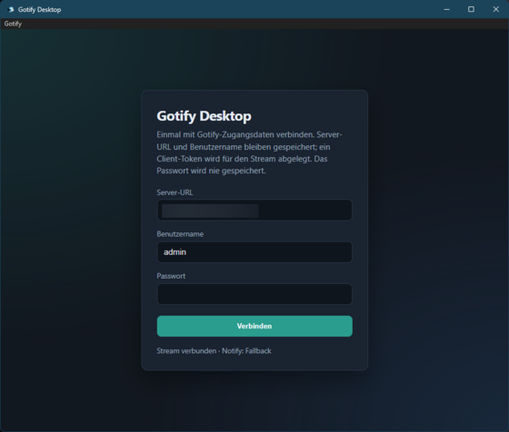
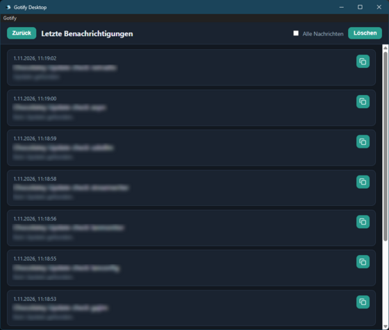
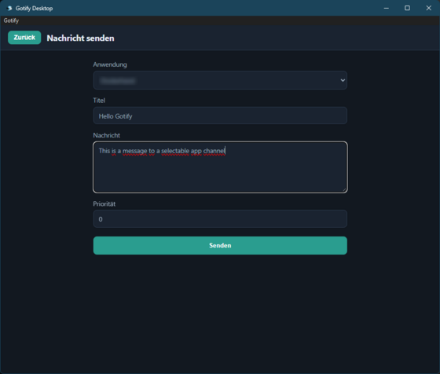

# Gotify Desktop

[](https://github.com/elpatron68/gotify-desktop/actions/workflows/ci.yml)
[](https://github.com/elpatron68/gotify-desktop/actions/workflows/ci.yml)
[](https://github.com/elpatron68/gotify-desktop/releases)
[](https://v3.wails.io)
[](https://github.com/elpatron68/gotify-desktop/blob/main/go.mod)
[](https://nodejs.org/)
[](#installation)

Desktop client for a self-hosted [Gotify](https://gotify.net/) server. The app shows new messages as desktop notifications, keeps a short history, and stays available from the system tray.

Prebuilt packages are available for **Linux (x86_64)**, **Windows (x86_64)**, and **macOS (Apple Silicon)**.

## Screenshots

<table>
  <tr>
    <td align="center" valign="top" width="33%">
      
      <br>
      <sub>Sign in. The password is not stored.</sub>
    </td>
    <td align="center" valign="top" width="33%">
      
      <br>
      <sub>Recent notifications</sub>
    </td>
    <td align="center" valign="top" width="33%">
      
      <br>
      <sub>Send a message to an application</sub>
    </td>
  </tr>
</table>

## Features

- Sign in with your Gotify username and password. The password is not stored; the app creates a client token.
- Native desktop notifications when the server sends a new message.
- System tray on Linux, Windows, and macOS: open the window, recent notifications, send a message, settings, start at login, and quit. macOS also keeps the application menu.
- History of the last 100 notifications. Copy an entry as Markdown or clear the list. Store toast notifications only, or every message.
- Send a message: pick one of your Gotify applications and submit a title, body, and priority. The application token stays inside the app.
- Updates on startup (at most every 24 hours) and via **Check for Updates**. The app asks before installing and checks the file against `SHA256SUMS`.
- Start at login.
- Closing the window leaves the app in the tray. Quit from the tray menu or the application menu.
- Window size, position, and maximised state are remembered. Positions on a monitor left of or above the primary display may be discarded. Under Wayland the system often reports `0,0`, so only size and maximised state are restored.
- The Gotify web UI is embedded in the app.
- Interface languages: German, English, French, and Spanish. The default is the operating-system language, or English if that language is not bundled. Change it via **Language** in the tray or the application menu.

## Installation

The current version is on the [releases page](https://github.com/elpatron68/gotify-desktop/releases/latest). The links below always point at that release.

| System | Recommended | Alternative |
|--------|-------------|-------------|
| Linux x86_64 | [AppImage](https://github.com/elpatron68/gotify-desktop/releases/latest/download/gotify-desktop-linux-amd64.AppImage) | [Binary](https://github.com/elpatron68/gotify-desktop/releases/latest/download/gotify-desktop-linux-amd64) |
| Windows x86_64 | [Setup](https://github.com/elpatron68/gotify-desktop/releases/latest/download/gotify-desktop-windows-amd64-setup.exe) | [Portable EXE](https://github.com/elpatron68/gotify-desktop/releases/latest/download/gotify-desktop-windows-amd64.exe) |
| macOS Apple Silicon | [DMG](https://github.com/elpatron68/gotify-desktop/releases/latest/download/gotify-desktop-darwin-arm64.dmg) | [ZIP](https://github.com/elpatron68/gotify-desktop/releases/latest/download/gotify-desktop-darwin-arm64.zip) |

Checksums: [SHA256SUMS](https://github.com/elpatron68/gotify-desktop/releases/latest/download/SHA256SUMS). The packages are not signed.

Other architectures (Linux arm64, Windows ARM, Intel Macs) are not built.

### Linux

The AppImage and the binary need GTK 4 and WebKitGTK 6.0 from the system. The AppImage does not bundle those libraries. The tray icon also needs an AppIndicator library and a panel that hosts status icons.

Ubuntu 24.04:

```bash
sudo apt install libgtk-4-1 libwebkitgtk-6.0-4 libayatana-appindicator3-1 libfuse2t64
```

`libfuse2t64` is only required for the AppImage. Without FUSE:

```bash
chmod +x gotify-desktop-linux-amd64.AppImage
APPIMAGE_EXTRACT_AND_RUN=1 ./gotify-desktop-linux-amd64.AppImage
```

With FUSE:

```bash
chmod +x gotify-desktop-linux-amd64.AppImage
./gotify-desktop-linux-amd64.AppImage
```

The binary:

```bash
chmod +x gotify-desktop-linux-amd64
./gotify-desktop-linux-amd64
```

Verify the download (`SHA256SUMS` in the same directory):

```bash
sha256sum -c SHA256SUMS
```

Fedora and similar distributions, tray library:

```bash
sudo dnf install libappindicator-gtk3 gnome-shell-extension-appindicator
```

Arch:

```bash
sudo pacman -S libappindicator-gtk3
```

GTK 4 and WebKitGTK 6.0 must be installed there as well.

#### System tray

KDE Plasma, Xfce, MATE, and Cinnamon usually show the icon on their own. GNOME 45 and later has no classic tray. Without an extension the app still runs, but after sign-in the window disappears on purpose because it moves to the tray.

Ubuntu GNOME:

```bash
sudo apt install libayatana-appindicator3-1 gnome-shell-extension-appindicator
```

Then enable **AppIndicator and KStatusNotifierItem Support** and log out and back in if the icon is missing. It sits in the top bar, not in the Activities grid.

If the switch stays greyed out:

```bash
gsettings set org.gnome.shell disable-user-extensions false
gnome-extensions enable appindicatorsupport@rgcjonas.gmail.com
```

Hyprland, Sway, and other wlroots setups need a panel with a Status Notifier host, for example Waybar's tray module. WSL without a desktop session often has no tray at all.

#### Wayland

The app runs under Wayland. Size and maximised state are saved; the screen position often is not. Notifications go through `xdg-desktop-portal`. Plasma and GNOME provide one. A minimal Hyprland session needs the portal package as well. If the app starts before the session bus is ready, the tray or notifications can miss the first attempt; restarting the app afterwards is enough.

### Windows

The setup (`gotify-desktop-windows-amd64-setup.exe`) installs the app. `gotify-desktop-windows-amd64.exe` is portable and needs no installer. Automatic updates replace that EXE, not the setup.

Windows 10 and 11 usually already include the [WebView2 runtime](https://developer.microsoft.com/microsoft-edge/webview2/). If it is missing, the window stays blank until the runtime is installed.

The packages are not signed. SmartScreen may warn on the first launch.

### macOS

Apple Silicon (arm64) only. The DMG contains `Gotify Desktop.app` and a link to Applications. The ZIP contains `gotify-desktop.app`.

Builds are unsigned and not notarized, so macOS blocks the first launch. In Finder, right-click the app, choose **Open**, then **Open** again. Or, depending on which bundle you installed:

```bash
xattr -dr com.apple.quarantine "/Applications/Gotify Desktop.app"
```

Automatic updates use the ZIP, not the DMG.

## Settings

Configuration and history are stored in the user directory:

| System | Folder |
|--------|--------|
| Linux | `~/.config/gotify-desktop/` |
| macOS | `~/Library/Application Support/gotify-desktop/` |
| Windows | `%AppData%\gotify-desktop\` |

That folder holds `config.json` (server, token, language, autostart, window, last update check), `history.json` (the last 100 notifications), and `notify.log` (notes when notifications do not appear).

## For developers

### Requirements

| Platform | To build |
|----------|----------|
| Linux | Go 1.26+, Node.js 24+, `libgtk-4-dev`, `libwebkitgtk-6.0-dev`, `gcc`, `pkg-config` |
| Windows | Go 1.26+, Node.js 24+, WebView2 runtime |
| macOS | Go 1.26+, Node.js 24+, Xcode Command Line Tools |

Ubuntu 24.04:

```bash
sudo apt install build-essential pkg-config libgtk-4-dev libwebkitgtk-6.0-dev
```

Wails v3 CLI (`$HOME/go/bin` on `PATH`):

```bash
go install github.com/wailsapp/wails/v3/cmd/wails3@v3.0.0
```

Running a prebuilt binary only needs the runtime packages in [Linux](#linux). The dev packages are for building.

### Develop

```bash
cd frontend && npm install && cd ..
wails3 dev
```

### Build

```bash
wails3 build
```

The binary is `bin/gotify-desktop` (`.exe` on Windows, `.app` on macOS).

```bash
wails3 build GOOS=windows GOARCH=amd64
wails3 build GOOS=darwin GOARCH=arm64
wails3 build GOOS=linux GOARCH=amd64
```

Local packages:

```bash
# Windows (NSIS on PATH)
wails3 package GOOS=windows GOARCH=amd64

# Linux AppImage (after wails3 build)
./packaging/linux/build-appimage.sh bin/gotify-desktop dist linux-amd64

# macOS DMG (after wails3 build)
./packaging/darwin/build-dmg.sh bin/gotify-desktop.app dist darwin-arm64
```

A version tag creates the GitHub release:

```bash
git tag v0.1.9
git push origin v0.1.9
```

### CI and release files

[`.github/workflows/ci.yml`](.github/workflows/ci.yml) runs on pushes and pull requests to `main` and on `v*` tags:

1. Unit tests
2. Builds for Linux amd64, Windows amd64, and macOS arm64
3. Packages as workflow artifacts, and on tags also attached to the GitHub release

| Platform | Files |
|----------|-------|
| Windows | `gotify-desktop-windows-amd64-setup.exe`, `gotify-desktop-windows-amd64.exe` |
| Linux | `gotify-desktop-linux-amd64.AppImage`, `gotify-desktop-linux-amd64` |
| macOS | `gotify-desktop-darwin-arm64.dmg`, `gotify-desktop-darwin-arm64.zip` |
| All | `SHA256SUMS` (GNU `sha256sum`, two spaces) |

### Automatic updates

The app queries `releases/latest` over HTTPS (User-Agent `gotify-desktop/<version>`). When a newer `major.minor.patch` is published, a dialog asks to install. After confirmation the matching package and `SHA256SUMS` are downloaded, the hash is checked, and a helper process replaces the running install.

| Running as | Update package |
|------------|----------------|
| Linux AppImage (`APPIMAGE` set) | `gotify-desktop-linux-<arch>.AppImage` |
| Linux binary | `gotify-desktop-linux-<arch>` |
| Windows EXE | `gotify-desktop-windows-<arch>.exe` (not the NSIS setup) |
| macOS `.app` | `gotify-desktop-darwin-<arch>.zip` |

Builds with version `0.0.0` skip the check. If the matching package is missing, the app shows an error and the releases URL. Integrity comes from HTTPS and `SHA256SUMS`, not from a signature. Manual check: **About → Check for Updates**.

### Configuration

Fields in `config.json`: `server_url`, `client_token`, `min_priority` (default `0`), `last_message_id`, `autostart`, `locale` (optional BCP-47 tag such as `de` or `en`; empty = OS language), `history_mode` (`toasts` or `all`; empty or unknown becomes `toasts`), `window_width` / `window_height` (0 or missing = 1100×800, minimum 640×480), `window_x` / `window_y` with `window_pos_set` (so `0,0` is valid), `window_maximised`, `update_checked_unix`.

UI strings live in `internal/i18n/locales/*.json`. English is the fallback. Bundled languages: `en`, `de`, `fr`, `es`.

Check only the WebSocket stream:

```bash
GOTIFY_URL=https://gotify.example.com GOTIFY_TOKEN=... go run ./cmd/streamcheck
```

Quick check that the Linux tray host is reachable:

```bash
ldconfig -p | grep -i appindicator
echo "$DBUS_SESSION_BUS_ADDRESS"
echo "$XDG_SESSION_TYPE"
gnome-extensions list 2>/dev/null | grep -i indicator || true
```

## License

MIT — see [LICENSE](LICENSE).
